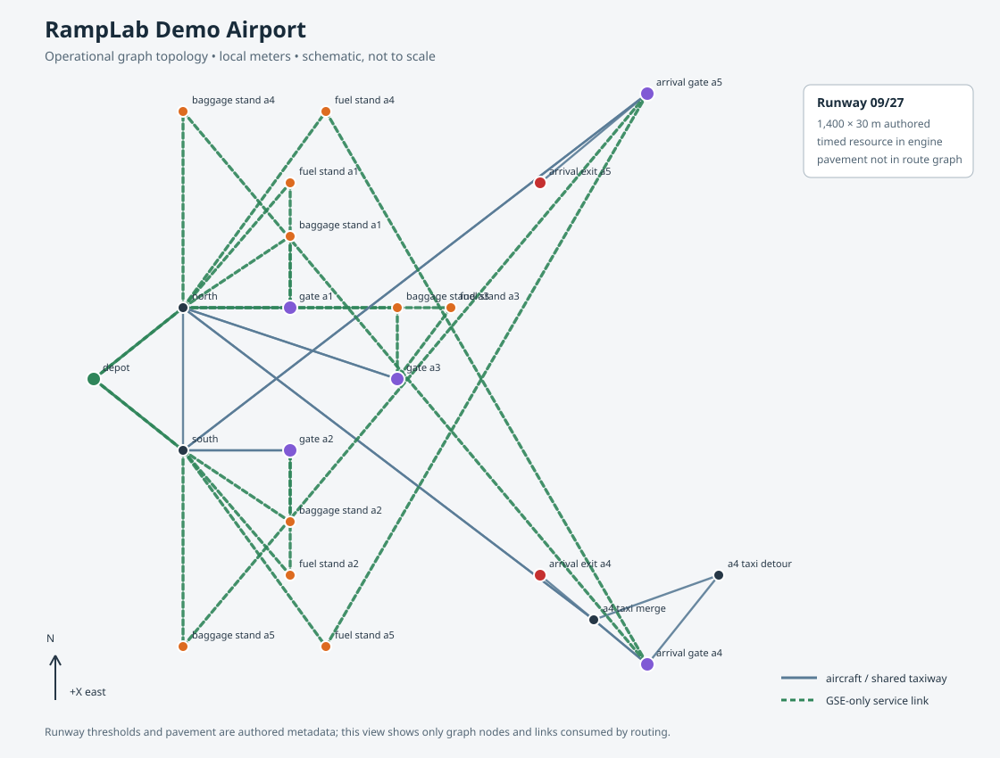

# Goal 50: RampLab Demo Airport

## Purpose and boundary

RampLab Demo Airport is a fictional, fully specified operational world for product demonstrations and deterministic simulator work. It is the primary polished-demo foundation because its synthetic geometry and permissions are known by construction while KAUO production routing remains evidence-limited. It does not replace the evidence-backed KAUO research environment, which remains `DATA_BLOCKED` where its evidence is incomplete. No Demo Airport geometry or permissions are KAUO evidence.

All dimensions and operational metadata below are RampLab-authored assumptions. The simulator's timed runway resource, abstract crew tasks, and timed pushback are called out separately from derived map geometry.

## Local layout



The canonical definition is [ramplab_demo_airport.yaml](../scenarios/ramplab_demo_airport.yaml). Its `airport.design` block defines the physical and semantic assumptions; the same file's graph supplies the operational routing nodes, edges, permissions, and traversal times. The loader resolves these into `AirportDesign` and the engine graph, validates reference and centerline consistency, and exposes both through snapshot schema 2.

| Feature | Authored design |
|---|---|
| Coordinate frame | Local meters; origin node `(0,0)`; +X east, +Y north, +Z up; Unreal scale 100 cm/m; no Cesium dependency |
| Runway | 09/27 asphalt; thresholds `(-700,0)` and `(700,0)`; 1,400 × 30 m; two arrival exits at X = -250 m and +250 m |
| Taxiway A | Parallel east-west corridor at Y = 100 m; 18 m asphalt; 15 m modeled centerline clearance; aircraft routing only |
| Runway hold | `hold_09` at `(-500,100)`; 15 m protected-clearance assumption; outside runway pavement |
| Apron and stands | Shared concrete apron region; five 52 × 45 m stands A1–A5 at Y = 270 m; 36 m maximum wingspan and 8 m wingtip-clearance assumptions; pushback points north toward the taxi corridor |
| GSE network | 7 m paved service-road corridors at Y = 430 m, plus stand access spurs; 4 m clearance assumption; explicit GSE-only permissions |
| Support areas | GSE depot, fuel staging, maintenance/overflow, and terminal/apron footprints |

The plan-view SVG is generated from the same YAML polygons and route graph. Runway pavement, taxiway, apron, service road, stands, and support footprints are dimensioned in the data. Route-edge lengths are derived from their local endpoints and checked against authored centerlines. Stand access and service access are explicitly linked to their gate and graph edges.

GSE service-road travel uses paired directed graph edges for the two directions along each corridor. This gives the existing reservation system distinct traversal identities for outbound and return movements. The physical route centerlines remain those of the same authored corridor; the representation does not assert separate paved lanes.

## Simulator behavior and limits

The canonical scenario contains five aircraft and five overlapping turnarounds. Two aircraft arrive through the runway, clear to the authored exits, taxi to A4/A5, complete servicing, push back, taxi, queue, and depart. Three additional flights exercise stand-start turnarounds and departures. Two mobile vehicles (one fuel truck and one baggage cart) serve all five stands, producing service-resource contention. Abstract crew resources perform deboarding, cabin cleaning, and pushback preparation.

The C++ engine remains the operational source of truth. It owns runway sequencing, taxi movement, gate occupancy, turnaround dependencies, service assignments, and deterministic replay. Runway pavement and thresholds are represented as design geometry, while runway occupancy is still modeled as a timed resource at `hold_09`; the engine does not simulate takeoff-roll movement over runway pavement. Pushback is a timed aircraft movement; no tug vehicle is required or represented. Width, clearance, compatibility, and footprint data are validated as authored design inputs but are not yet used for runtime swept-volume clearance calculations.

## Seed 50 result

Release CLI run from the canonical YAML:

| Measure | Result |
|---|---:|
| Aircraft / completed turnarounds | 5 / 5 |
| Completed arrivals / departures | 2 / 5 |
| Required turnaround tasks completed | 30 / 30 |
| Mobile service requests completed | 30 / 30 |
| Simulated duration | 12,747 s |
| Mean departure delay | 3,133.4 s (52.2 min) |
| Runway operations / maximum queue depth | 7 / 2 |
| Fleet collisions / unresolved deadlocks | 0 / 0 |
| Surface safety failures | 0 |
| Aircraft-aircraft / aircraft-ground collisions | 0 / 0 |
| Failed routes / unfinished service requests | 0 / 0 |

The large delays are intentional contention in this small two-vehicle fixture, not a capacity or schedule-performance claim. Safety thresholds and routing permissions remain enabled.

## Validation and repeatability

The focused Goal 50 tests validate design parsing, runway/exit/hold metadata, all five stands, support and surface regions, typed graph permissions, centerline geometry, aircraft and GSE reachability, snapshot export, complete lifecycle results, safety metrics, and same-seed event/metric equivalence. Release CTest completed successfully with 232/232 tests passing.

Release validation commands:

```powershell
cmake -S . -B build-goal50 -G Ninja -DCMAKE_BUILD_TYPE=Release -DBUILD_TESTING=ON
cmake --build build-goal50 --config Release --parallel 8
ctest --test-dir build-goal50 -C Release --output-on-failure
./build-goal50/airside_cli.exe --scenario scenarios/ramplab_demo_airport.yaml --seed 50 --quiet --metrics-json evidence/goal50/metrics.json --record-events evidence/goal50/events.jsonl
python tools/goal50/render_demo_airport.py
```

Two clean seed-50 CLI executions produce byte-identical `metrics.json` and `events.jsonl`. The topology generator is deterministic as well. The evidence bundle is in [evidence/goal50](../evidence/goal50) and includes representative metrics, the ordered event trace, the dimensioned SVG, and a SHA-256 manifest.

## Future work

The airport is ready as an operational synthetic fixture and data source for a later Unreal visualization goal. Useful next steps are rendering the design polygons and route metadata in Unreal, adding runtime aircraft-envelope clearance checks when supported by the engine, and creating separate disruption/recovery scenarios for runway closure, GSE outage, gate conflict, and surge traffic. Keep those additions separate from KAUO evidence and readiness.
